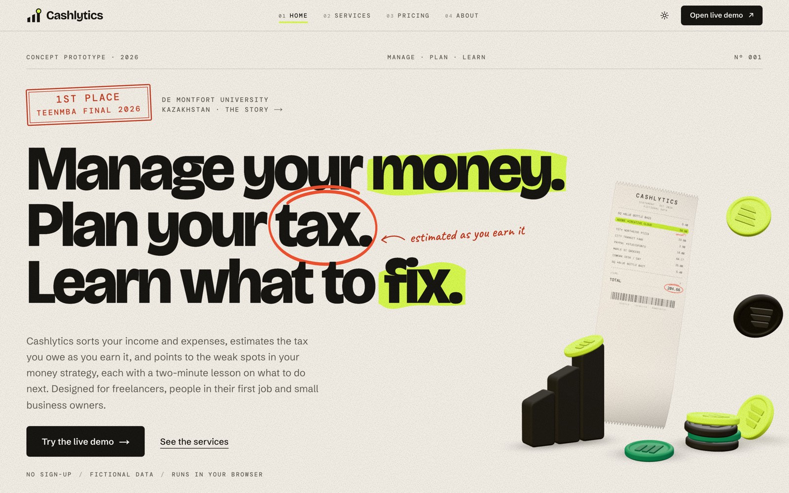
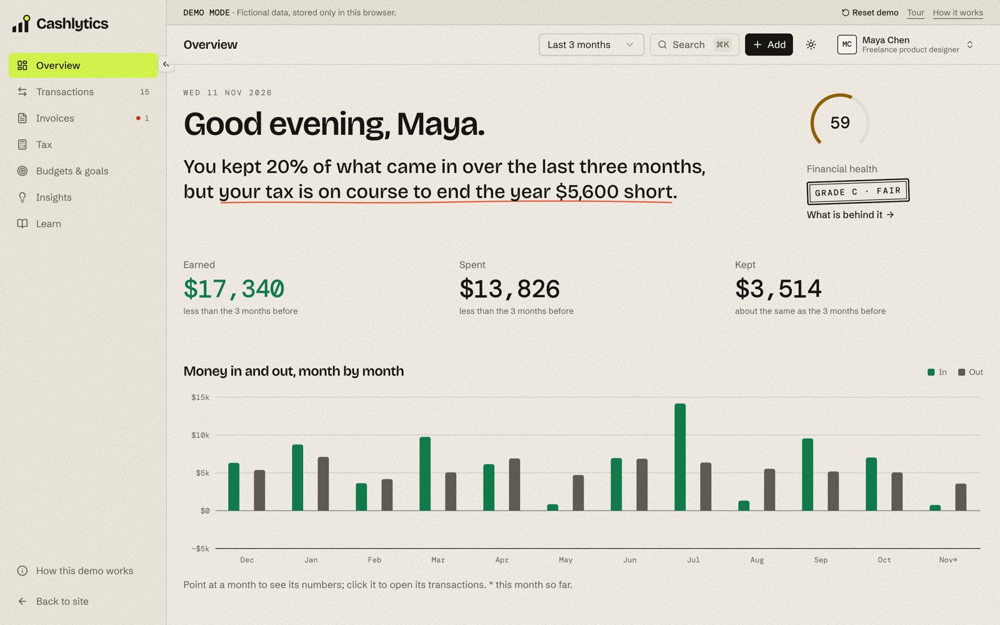
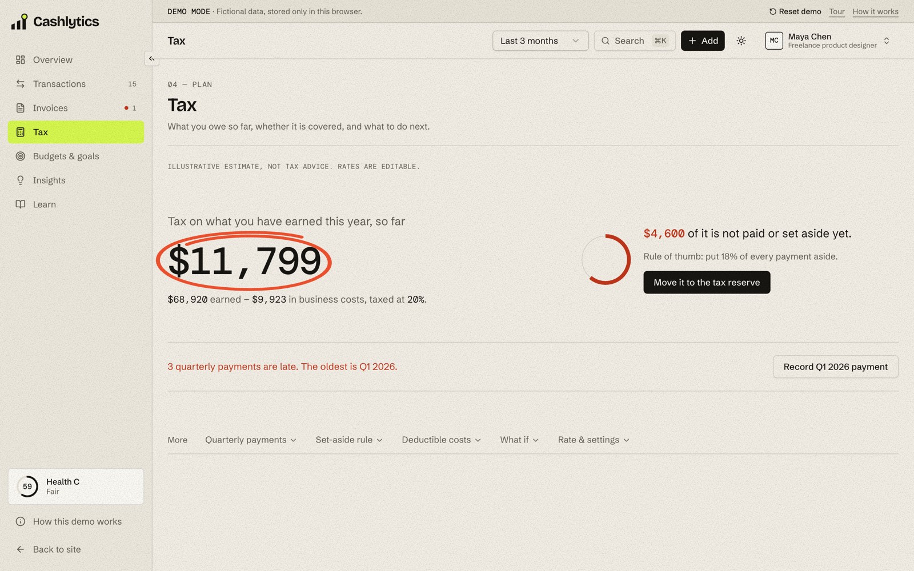

# Cashlytics

Cashlytics is a concept for a financial-analytics service for individuals, freelancers and small businesses: track income and expenses, estimate tax as you earn, and find the weak points in your money strategy, with short lessons on what to do about them. The pitch line was **Manage · Plan · Learn**.

It started in April 2026 as a two-person team project for the final of the **TeenMBA programme at De Montfort University Kazakhstan**, where it took **1st place** and a 35% tuition scholarship. I built this prototype and led the market and audience research; the team developed the strategy and financial model together. The website and the in-browser demo in this repository were rebuilt in November 2026.



## What is real and what is not

Real:

- The website (`/`, `/services`, `/pricing`, `/about`).
- The in-browser demo at `/demo`: you can add and recategorise transactions, import a CSV, create invoices and mark them paid, set budgets and goals, and read the lessons.
- The rule engines behind it (categoriser, tax estimate, health score, weak points, forecast) and their tests.

Not real:

- There is no backend, no bank connection and no accounts. Nothing you do in the demo leaves your browser.
- There are no customers or users.
- All data is fictional and generated in the browser.
- Tax figures are illustrative, not tax advice, and follow no country's law.
- Pricing tiers are planned, not on sale. An AI assistant is on the planned list; nothing in the demo uses AI.

## Live demo

Live: https://cashlytics-demo.vercel.app (the demo itself is at [/demo](https://cashlytics-demo.vercel.app/demo))

The demo needs no sign-up. Add `?persona=freelancer`, `?persona=starter` or `?persona=business` to any `/demo` URL to open a specific persona.

## A short tour of the demo

There are three fictional personas, each built from the audience research, and each with a money story that the data is generated to reveal:

| Persona | Who | Weak points the data reveals |
| --- | --- | --- |
| `freelancer` | Maya Chen, freelance product designer | Under-reserved for tax, and one client (Northwind Logistics) who pays more than a month late |
| `starter` | Daniel Okafor, junior data analyst in his first full-time job | Subscriptions that crept up over the year, and less than a month of spending as a buffer |
| `business` | Brew & Bloom, a two-person coffee kiosk | Supplier costs rising faster than sales, and a thin cash runway |

The pages: **Overview** (one sentence about where the money stands, three figures, one cash-flow chart, what to do next), **Transactions** (search, filters, review queue, rules, CSV import and export), **Invoices** (create, preview, print, mark paid), **Tax** (the estimate, what is covered, the next payment, quarterly schedule and a what-if), **Budgets & goals**, **Insights** (health score and weak points, plus subscriptions, spending jumps, income stability and a forecast) and **Learn** (ten two-minute lessons, each with one sentence about your own numbers).

The moment that shows the modules are connected: mark Maya's overdue invoice paid. A linked income transaction appears, the tax estimate goes up, and the health score and the weak points change with it. The 60-second tour (the "Tour" link in the demo strip, or "Start the tour" in the `⌘K` palette) walks through exactly that.



## How it works

Everything runs client-side. The code that matters is plain TypeScript in `lib/demo/`:

- **Generator** (`generate.ts`, `prng.ts`, `personas.ts`): 13 months of bank-style transactions, invoices, budgets and goals from a seeded PRNG (mulberry32). The seed is the persona plus the calendar month, so the same month always produces the same data, and untouched data is regenerated so it always ends today.
- **Categoriser** (`categorize.ts`, `categories.ts`): a rule engine, not a model. Your own rules come first, then a merchant dictionary, then keyword patterns, then "uncategorised". Every result carries a confidence and a plain reason (`Matched "uber" → Transport`). Anything under 70% sure waits in a review queue; fixing one can save a rule for that merchant. The generated data goes through the same categoriser, which is why a few transactions start in the queue.
- **Tax** (`tax.ts`, `tax-dates.ts`): a generic estimate on profit (taxable income minus deductible costs), flat rate or brackets, with quarterly payments, what is already paid or set aside, a suggested set-aside rate and a what-if.
- **Insights** (`insights.ts`): a health score from six weighted checks (savings rate, emergency buffer, income stability, tax readiness, budgets, receivables) and weak points sorted by impact, each with real numbers, an action and a lesson. Also subscription detection, spending jumps and a cash forecast.
- **The rest**: `analytics.ts` (periods, totals, series), `invoices.ts`, `csv.ts`, `quick-add.ts` (`coffee 4.50 yesterday`), `lessons.ts`, `search.ts` (command palette), `reducer.ts` (every change as a pure action).
- **State** (`store.tsx`, `storage.ts`): one store per tab, saved to `localStorage` under `cashlytics-demo:v1:<persona>`. Tabs follow each other through the `storage` event, so an edit in one tab shows up in another. "Reset demo" clears that persona's data and the demo's interface keys.

## Routes

| Route | Page |
| --- | --- |
| `/` | Home |
| `/services` | What the product would do, module by module |
| `/pricing` | Planned tiers |
| `/about` | The story and what is real |
| `/demo` | Overview |
| `/demo/transactions` | Transactions, review queue, rules, import |
| `/demo/invoices` | Invoices |
| `/demo/tax` | Tax estimate |
| `/demo/plan` | Budgets and goals |
| `/demo/insights` | Health score and weak points |
| `/demo/learn` | Lessons (`?lesson=<id>` opens one) |
| `/demo/about` | How the demo works |

## Stack

Next.js 16 (App Router), React 19, TypeScript (strict), Tailwind CSS 4, shadcn/ui on Radix, `motion`, Lenis, three.js with React Three Fiber and drei, Recharts, cmdk, sonner, next-themes, Vitest. Package manager: pnpm.

## Run locally

```bash
pnpm install
pnpm dev        # http://localhost:3000
pnpm test
pnpm lint
pnpm typecheck
pnpm build
```

CI runs install, lint, typecheck, tests and build on every push (`.github/workflows/ci.yml`).

## Tests

174 tests in 17 files under `lib/demo/__tests__`, all on the pure modules: the generator (determinism and the invariants each persona's story depends on), the categoriser, analytics, tax, insights and weak points, invoices, CSV parsing, quick add, lessons, formatting, the reducer (including what marking an invoice paid changes, and transfers), the command-palette search, and storage (resolving saved state, reset, and how a tab reacts to changes made in another tab).

## Design notes

The identity is "the annotated statement": a ledger printed on warm paper, numbers in a typewriter mono, and marks on top of it, a lime highlighter, a circled figure, a margin note, a rubber stamp. The marketing pages use choreographed motion and three procedural three.js scenes (a receipt, coins, a jar for the tax reserve) built from code and canvas textures, with no downloaded models. The demo uses the same identity more quietly, with one idea per screen. With reduced motion everything renders in its final state, and without WebGL the 3D scenes fall back to static drawings.



## Limitations and next steps

- It is a prototype: data lives in one browser, there are no accounts and nothing syncs between devices.
- No bank connection. Real transactions would need an open-banking provider or statement uploads processed on a server.
- The tax model is deliberately generic. A real product would need country-specific rules, checked by a professional.
- The categoriser only knows the merchants and keywords it was given; real statements would need a much larger dictionary and learning from corrections.
- The interface is English and USD only.
- Next steps follow the pitch roadmap: an MVP with real accounts, then integrations, then scaling and monetisation.
